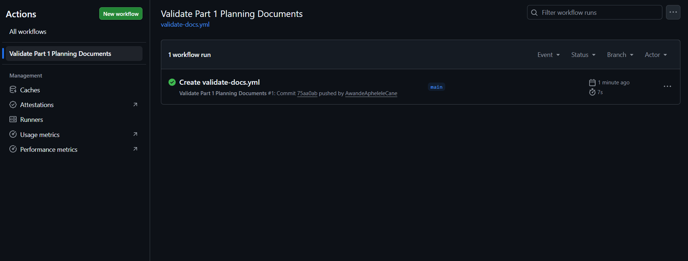

# ST10447692
Portfolio of Evidence (PoE) PART 1 PROG6212w SEMESTER 2
# RaceDay – Part 1: System Planning and Database

## Short Description
RaceDay is a full-stack web-based event management system designed for the South African road running, walking, and cycling community.  
This repository contains **Part 1** of the project, which focuses purely on system planning and database design before any application code is written.

In this part I delivered:
- A complete Entity Relationship Diagram (ERD)
- A full API Endpoint Plan
- A working SQL Server script that creates the database schema and seeds realistic sample data

## User Roles
The system supports two distinct roles:

- **Organiser**  
  Can create, edit, and delete events, manage event categories, capture participant results, and view all event enrolments.

- **Participant**  
  Can create an account, browse upcoming events, enter an event by selecting a category, view their own enrolments, and track their personal results.

## Documentation (Part 1)
All planning documents are located in the `/docs` folder:

- `RaceDay_ERD.png` – Entity Relationship Diagram
- `API_Endpoint_Plan.md` – Complete list of planned API endpoints
- `RaceDay_Schema_and_Seed.sql` – Full database creation and seed script

## CI/CD
A GitHub Actions workflow has been configured to validate that all required Part 1 files exist in the repository.

**Successful build screenshot:**

<!-- Drag and drop your green CI/CD screenshot below this line -->

## Video Presentation
Watch the Part 1 walkthrough video here:  
[Part 1 Video – RaceDay Planning & Database](https://youtu.be/_3KBAdNk4aU)

## How to Run the SQL Script
1. Open SQL Server Management Studio (SSMS)
2. Connect to your local SQL Server instance
3. Open the file `docs/RaceDay_Schema_and_Seed.sql`
4. Execute the script (F5)
5. The `RaceDay` database will be created with sample data

---
**Student:** Awande Aphelele Cane  
**Module:** PROG6212w  
**Part:** 1 of 3
# RaceDay API – Part 2

## Description
RaceDay is a full-stack event management system for South African road running, walking and cycling events.  
This repository contains **Part 2**: the complete RESTful API built with ASP.NET Core, Entity Framework Core (Code-First), and session-based (cookie) authentication.

## User Roles

- **Organiser**  
  Can create, update and delete events, manage categories, view all enrolments for their events, and capture results.

- **Participant**  
  Can register, browse events and categories, enrol in an event by selecting a category, view their own enrolments, and view their personal results.

## Technologies Used
- ASP.NET Core Web API
- Entity Framework Core (Code-First)
- SQL Server
- Cookie Authentication (Session-based)
- Role-based Authorization
- Swagger / OpenAPI
- xUnit Unit Tests
- GitHub Actions CI/CD

## Setup & Run Instructions

1. Clone the repository
2. Open the solution in Visual Studio 2022
3. Update the connection string in `appsettings.json` if needed
4. Open Package Manager Console and run:
   5. Press F5 to run the API
6. Open Swagger UI at: `https://localhost:7xxx/swagger`

## Testing the API
All endpoints can be tested directly in Swagger:
1. Register a new Organiser and a Participant
2. Login (session cookie is set automatically)
3. Create an Event (must include Distance and EventType)
4. Add Categories
5. Enrol as a Participant
6. Capture Results as an Organiser

## Unit Tests
Unit tests cover:
- User registration and login (success and failure)
- Role-based access (Organiser vs Participant)
- Event management
- Enrolments

Run tests in Visual Studio via **Test Explorer** or with:
## CI/CD
GitHub Actions automatically builds the project and runs all unit tests on every push.

**Successful green build:**

## Video Presentation
Watch the Part 2 demonstration video here:  
[RaceDay Part 2 – API Walkthrough](https://youtu.be/YOUR_UNLISTED_VIDEO_LINK)

## Student Details
- Name: Awande Aphelele Cane
- Student Number: ST10447692
- Module: [PROG6212w
